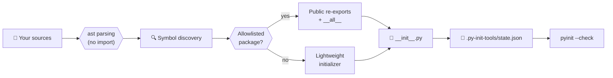

<!--
SPDX-FileCopyrightText: 2026 Clément RACINET

SPDX-License-Identifier: X11
-->

<div align="center">

# 🧬 py-init-tools

**Your `__init__.py` files, generated, audited and never out of sync.**

Create, update and check Python package initializers, without ever importing your code.<br>
Dry-run by default · static analysis (`ast`) · manual files protected · CI-ready · zero dependencies.

[Quick start](#-quick-start) ·
[See it in action](#-see-it-in-action) ·
[Discovery](#-symbol-discovery) ·
[Re-exports](#-public-re-exports) ·
[Tracking](#-generated-file-tracking) ·
[Configuration](#%EF%B8%8F-configuration) ·
[FAQ](#-faq)

</div>

---

## 🎯 What is it?

Every Python package needs its `__init__.py` files: for imports, for test
discovery, for a clean public API. Writing them by hand is tedious, and
`__all__` lists drift from the real code. Generators that fix this often
**import your modules** (running import-time side effects) or **overwrite files
you wrote yourself**.

`py-init-tools` is a small Python CLI (`pyinit`) that does neither. It reads
your source with `ast`, generates what is missing, and tells you in CI when
something is outdated:

- **Generate** missing `__init__.py` files for packages and test folders.
- **Discover** public classes, functions, constants and type aliases statically.
- **Re-export** a public API, only for packages you explicitly allowlist.
- **Protect** hand-written files: nothing is overwritten by default.
- **Track** every generated file with a sentinel and a JSON registry.
- **Check** everything in CI with a single command.

It has **no runtime dependency** and **never imports the code it analyzes**.

---

## 🚀 Quick start

```bash
pip install git+https://gitlab.com/dev-tools-cr/python/py-init-tools.git
pyinit
```

Requires **Python 3.12+**. Works on Windows, macOS and Linux.

`pyinit` alone is a **dry-run**: it shows what would change and writes nothing.

<details>
<summary>Other ways to install</summary>

```bash
# pipx: isolated global command
pipx install git+https://gitlab.com/dev-tools-cr/python/py-init-tools.git

# uv: run without installing
uvx --from git+https://gitlab.com/dev-tools-cr/python/py-init-tools.git pyinit
```

With **Pixi**, add the package to another project as a PyPI Git dependency:

```toml
[pypi-dependencies]
py-init-tools = { git = "https://gitlab.com/dev-tools-cr/python/py-init-tools.git" }
```

```bash
pixi update
```

</details>

### The three modes

```bash
pyinit             # preview: dry-run, nothing is written
pyinit --write     # create and update generated files
pyinit --check     # exit 1 if anything is missing, modified or outdated
```

Run `pyinit --help` for every option, or `pyinit --version` to print the
installed version.

### Minimal configuration

```toml
# pyproject.toml
[tool.py-init-tools]
package_roots = ["src/my_package"]
test_roots = ["tests"]
```

Or pass paths directly:

```bash
pyinit --package-root src/my_package --test-root tests
```

---

## ✨ See it in action

Given a package with no initializers:

```text
src/my_package
├── api
│   ├── client.py
│   └── models.py
└── services
    └── internal.py
```

With `reexport_allowlist = ["api"]`, `pyinit --write` produces
`api/__init__.py` with a real public API:

```python
# @generated py-init-tools format=1 id=... version=1 revision=1
"""Api package.

Generated by py-init-tools — do not edit manually.
Source: https://gitlab.com/dev-tools-cr/python/py-init-tools
"""

from .client import ApiClient
from .models import ApiResponse

__all__ = [
    "ApiClient",
    "ApiResponse",
]
```

Packages **outside** the allowlist (here `services`) get a **lightweight
initializer with no eager import**, so you avoid circular imports and slow
startup by default.

Your test folders get minimal package markers, with no imports:

```python
# @generated py-init-tools format=1 id=... version=1 revision=1
# tests/unit/__init__.py
# Package marker — do not add imports here.
# Generated by py-init-tools — do not edit manually.
# Source: https://gitlab.com/dev-tools-cr/python/py-init-tools
```

---

## 💡 Why you'll like it

|                                  |                                                                                         |
| -------------------------------- | --------------------------------------------------------------------------------------- |
| 🔒 **Safe by default**           | Dry-run unless `--write` is passed. Nothing happens by accident.                        |
| 🧠 **Static analysis only**      | Modules are parsed with `ast`, never imported: no side effects, no circular imports.    |
| 🛡️ **Manual files protected**    | Files without a sentinel are left alone unless you pass `--overwrite-manual`.           |
| 🎯 **Explicit public API**       | Eager re-exports are opt-in per package through an allowlist.                           |
| 🔎 **Drift detection**           | Finds modified, outdated, deleted or recreated generated files.                         |
| 🧾 **Transparent tracking**      | Versions, revisions and SHA-256 hashes live in a readable JSON registry.                |
| 🪪 **License headers preserved** | SPDX headers, shebangs and encoding lines before the sentinel are kept on every update. |
| ✅ **CI-ready**                  | `pyinit --check` exits non-zero on any inconsistency.                                   |
| 🪶 **Zero dependency**           | No database, no secret, no external runtime dependency.                                 |

---

## 🧭 How it works



Your code is **read, never executed**. The registry then lets `--check` prove
that every generated file is still what the tool produced.

---

## 🖥️ Usage

### Preview changes

```bash
pyinit
pyinit --package-root src/my_package --test-root tests
```

### Write generated files

```bash
pyinit --write
```

### Check generated files

Exits with a non-zero status when generated files are missing, modified,
outdated or inconsistent with the registry. It is suitable for CI pipelines.

```bash
pyinit --check
```

### Skip test package markers

```bash
pyinit --write --skip-tests
```

### Overwrite manual or unrecognized files

Manual files are protected by default. To replace them intentionally:

```bash
pyinit --write --overwrite-manual
```

Use it for the first migration from an older marker-based version of
`py-init-tools`.

### Ignore manual files during checks

```bash
pyinit --check --ignore-manual-in-check
```

This applies only to files without a generated sentinel. Invalid or inconsistent
generated files still fail validation.

---

## 🔬 Symbol discovery

`py-init-tools` never imports target modules. It parses their source with
Python's `ast`. Three modes are available through `discovery_mode`.

| Mode                | What is exported                                                                  |
| ------------------- | --------------------------------------------------------------------------------- |
| `explicit_all`      | Only static module-level `__all__` declarations.                                  |
| `classes_functions` | `__all__` if present, otherwise public top-level classes and functions (default). |
| `all_public`        | Same, plus public constants and `TypeAlias` declarations (opt-in).                |

<details>
<summary><b><code>explicit_all</code></b></summary>

Lists, tuples, regular assignments and annotated assignments are supported:

```python
__all__ = ["ApiClient", "ApiResponse"]
```

</details>

<details>
<summary><b><code>classes_functions</code> (default)</b></summary>

An explicit `__all__` takes priority. Otherwise, public top-level classes and
functions are discovered:

```python
class ApiClient:
    pass


def create_client() -> ApiClient:
    return ApiClient()


class _InternalClient:
    pass
```

`ApiClient` and `create_client` are public. `_InternalClient` is ignored.

</details>

<details>
<summary><b><code>all_public</code></b></summary>

```toml
[tool.py-init-tools]
discovery_mode = "all_public"
export_constants = true
export_type_aliases = true
```

```python
from typing import TypeAlias

ClientName: TypeAlias = str
DEFAULT_TIMEOUT = 30
```

</details>

---

## 📤 Public re-exports

Eager re-exports are **disabled unless a package is allowlisted**:

```toml
[tool.py-init-tools]
reexport_allowlist = ["api", "services/public"]
```

Packages outside the allowlist receive lightweight initializers without eager
imports, which avoids circular imports and import-time side effects.

Root re-exports are controlled separately and disabled by default:

```toml
[tool.py-init-tools]
generate_root_reexports = true
```

### Excluding public-looking names

Some names look public but belong to the internal API. Exclude them by
directory or by module (paths are relative to the package root):

```toml
[tool.py-init-tools.private_names_by_dir]
"services/internal" = ["InternalClient", "LegacyService"]

[tool.py-init-tools.private_names_by_module]
"api/client.py" = ["InternalClient"]
```

---

## 🧾 Generated-file tracking

Every generated file carries a technical sentinel:

```python
# @generated py-init-tools format=1 id=... version=1 revision=1
```

The sentinel is checked against `.py-init-tools/state.json`, which stores:

- the generated file's UUID;
- its project-relative path;
- its version and revision;
- a SHA-256 hash of its generated body;
- creation and update dates;
- a short generation history.

The registry is plain JSON and contains no secret. **Commit it** with the
generated files:

```bash
git add .py-init-tools/state.json
```

```gitignore
# Optional: ignore temporary registry files
.py-init-tools/*.tmp
```

### Versions and revisions

- **Version** identifies an incarnation of a file.
- **Revision** identifies a content change within that incarnation.
- Deleting and recreating a tracked file increases the version.
- Changing or repairing generated content increases the revision.
- Running the tool without any change increments nothing.

| Event                                  | Result                |
| -------------------------------------- | --------------------- |
| First generation                       | version 1, revision 1 |
| Generated content changes              | version 1, revision 2 |
| File is manually modified and repaired | version 1, revision 3 |
| File is deleted and regenerated        | version 2, revision 1 |
| Nothing changes                        | no increment          |

The sentinel format version is independent from a file's version and revision.

<details>
<summary><b>License headers and preamble</b></summary>

The sentinel does not need to be on the first line. A preamble such as an SPDX
header is **preserved** whenever the file is updated or repaired, and is
**excluded** from the body's SHA-256 hash:

```python
# SPDX-FileCopyrightText: 2026 Example Author
#
# SPDX-License-Identifier: X11

# @generated py-init-tools format=1 id=... version=1 revision=1
"""My Python package.

Generated by py-init-tools — do not edit manually.
Source: https://gitlab.com/dev-tools-cr/python/py-init-tools
"""
```

By default, the sentinel is searched within the first 20 lines. Change it with:

```toml
[tool.py-init-tools]
sentinel_search_lines = 20
```

It must be a positive integer; invalid values fall back to `20`.

</details>

---

## 🔁 Keep everything up to date

### Daily workflow

```bash
pyinit            # 1. review the dry-run
pyinit --write    # 2. apply
pyinit --check    # 3. verify before committing

git add .py-init-tools/state.json
git add --all
```

### pre-commit

```yaml
# .pre-commit-config.yaml
repos:
  - repo: local
    hooks:
      - id: pyinit-check
        name: Check generated __init__.py files
        entry: pyinit --check
        language: system
        pass_filenames: false
```

### GitLab CI

```yaml
# .gitlab-ci.yml
init-check:
  image: python:3.13 # the full image includes git, needed by pip
  script:
    - pip install git+https://gitlab.com/dev-tools-cr/python/py-init-tools.git
    - pyinit --check
```

Use the **same configuration** in CI as locally, otherwise the check will report
a difference.

---

## ⚙️ Configuration

Set your defaults once in the target project's `pyproject.toml`:

```toml
[tool.py-init-tools]
package_roots = ["src/my_package"]
test_roots = ["tests"]

package_description = "My Python package."

generate_root_reexports = false
reexport_allowlist = ["api", "services/public"]

discovery_mode = "classes_functions"
export_constants = false
export_type_aliases = false

flat_subdirs = []
```

Command-line `--package-root` and `--test-root` override their configuration
values.

| Option                    | Type                   | Description                                                  |
| ------------------------- | ---------------------- | ------------------------------------------------------------ |
| `package_roots`           | `list[str]`            | Package roots to process.                                    |
| `test_roots`              | `list[str]`            | Test roots where package markers are generated.              |
| `package_version`         | `str \| null`          | Optional `__version__` written in root packages.             |
| `package_description`     | `str`                  | Root package docstring description.                          |
| `generated_marker`        | `str`                  | Human-readable notice included in generated files.           |
| `sentinel_search_lines`   | `int`                  | Initial lines searched for the sentinel (default `20`).      |
| `generate_root_reexports` | `bool`                 | Enable public re-exports from root packages.                 |
| `reexport_allowlist`      | `list[str]`            | Package-relative directories allowed to re-export symbols.   |
| `discovery_mode`          | `str`                  | Symbol discovery mode.                                       |
| `export_constants`        | `bool`                 | Export public constants in `all_public` mode.                |
| `export_type_aliases`     | `bool`                 | Export public `TypeAlias` declarations in `all_public` mode. |
| `flat_subdirs`            | `list[str]`            | Nested directories forced to behave as flat packages.        |
| `private_names_by_dir`    | `dict[str, list[str]]` | Names excluded by package-relative directory.                |
| `private_names_by_module` | `dict[str, list[str]]` | Names excluded by package-relative module.                   |
| `ignored_dir_names`       | `list[str]`            | Directory names ignored during discovery.                    |

`generated_marker` is only the human-readable notice. Generated-file identity is
managed separately through the sentinel and registry.

---

## 📚 CLI reference

<details>
<summary><b>All options</b></summary>

| Command                                   | Effect                                                       |
| ----------------------------------------- | ------------------------------------------------------------ |
| `pyinit`                                  | Dry-run: preview changes.                                    |
| `pyinit --write`                          | Create or update generated files.                            |
| `pyinit --check`                          | Fail if files are missing, modified, outdated, inconsistent. |
| `pyinit --package-root PATH`              | Package root to process (overrides configuration).           |
| `pyinit --test-root PATH`                 | Test root to process (overrides configuration).              |
| `pyinit --skip-tests`                     | Skip test package markers.                                   |
| `pyinit --overwrite-manual`               | Replace manual or unrecognized files.                        |
| `pyinit --check --ignore-manual-in-check` | Ignore files without a generated sentinel during checks.     |
| `pyinit --version`                        | Print the installed version and exit.                        |
| `pyinit --help`                           | Show all options.                                            |

`--write` and `--check` cannot be used together.

</details>

---

## ❓ FAQ

<details>
<summary><b>How do I generate missing <code>__init__.py</code> files in a Python project?</b></summary>

Install `py-init-tools`, run `pyinit` to preview the changes, then
`pyinit --write` to create them.

</details>

<details>
<summary><b>Does it import my code?</b></summary>

No. It parses source files with Python's `ast` module, so no import-time code is
ever executed.

</details>

<details>
<summary><b>Will it overwrite my hand-written <code>__init__.py</code>?</b></summary>

No. Files without a generated sentinel are treated as manual and protected
unless you pass `--overwrite-manual`.

</details>

<details>
<summary><b>How do I check <code>__init__.py</code> files in CI?</b></summary>

Run `pyinit --check`. It exits with a non-zero status if generated files are
missing, modified, outdated or inconsistent with the registry.

</details>

<details>
<summary><b>How do I generate <code>__all__</code> and public re-exports automatically?</b></summary>

Add the package to `reexport_allowlist` in `pyproject.toml`, then run
`pyinit --write`. The public classes and functions are discovered statically.

</details>

<details>
<summary><b>How do I avoid circular imports with generated <code>__init__.py</code> files?</b></summary>

Re-exports are opt-in per package. Every other package receives a lightweight
initializer with no eager imports.

</details>

<details>
<summary><b>Can I keep my SPDX license headers?</b></summary>

Yes. Everything placed before the sentinel is preserved on every update, and
excluded from the content hash.

</details>

<details>
<summary><b>Does it work with <code>src/</code> layouts and monorepos?</b></summary>

Yes. Configure one or several `package_roots` and `test_roots`.

</details>

<details>
<summary><b>Does it need any third-party package?</b></summary>

No. It has no external runtime dependency.

</details>

<details>
<summary><b>Which Python versions are supported?</b></summary>

Python 3.12 and later (3.12 and 3.13 are declared in the package).

</details>

---

## 🛠️ Development

This project uses [Pixi](https://pixi.sh) for its environment and tasks.

```bash
pixi run check     # lint + type check
pixi run format    # auto-fix and format
pixi run build     # build the package
```

Quality checks: Ruff (lint and format) and BasedPyright (strict).

### Versioning

Versions follow the date format `YYYY.M.D` (for example `2026.10.21`), with no
leading zero. A second release on the same day appends a segment: `2026.10.21.1`.

The version lives **only** in `pyproject.toml`. It is exposed as
`py_init_tools.__version__` and `pyinit --version`.

---

## 🧱 Design principles

- **Safe by default**: no writes without `--write`.
- **Static analysis only**: target modules are never imported.
- **Manual files are protected**: overwriting requires an explicit option.
- **Deterministic generation**: unchanged inputs produce unchanged files.
- **Explicit API exposure**: eager re-exports are allowlisted.
- **Transparent tracking**: metadata is stored as readable JSON.
- **Lightweight**: no database, secret or external runtime dependency.

---

## 📄 License

Copyright (c) 2026 Clément RACINET

Distributed under the X11 License with an additional no-endorsement clause.
See [`LICENSE`](LICENSE) for details.
